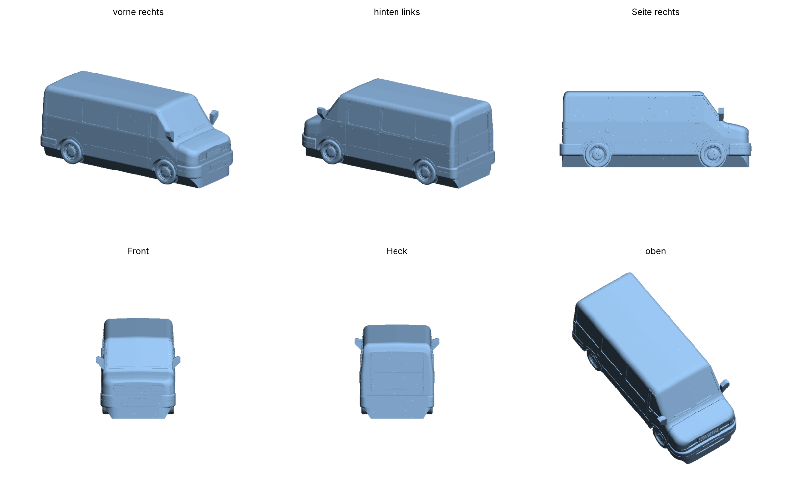
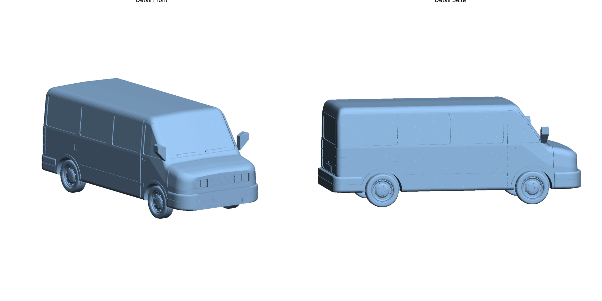

# VW T4 Modell (Multivan/Caravelle, kurze Front) zum 3D-Druck

Parametrisch erzeugtes Modell eines VW T4 als einteilige, wasserdichte STL
(geprüft: geschlossen, ein einziger Körper, keine degenerierten Dreiecke).




## Dateien

| Datei | Maßstab | Größe (L × B × H) | Hinweis |
|---|---|---|---|
| `vw_t4_1-30.stl` | 1:30 | 162 × 71 × 64 mm | **Empfohlen.** Mit Unterboden-Sockel, ohne Stützen druckbar |
| `vw_t4_1-30_ohne-sockel.stl` | 1:30 | 162 × 71 × 64 mm | Mit echter Bodenfreiheit, braucht Baum-Stützen |
| `vw_t4_1-43.stl` | 1:43 | 113 × 50 × 45 mm | Kleine Version (Details am Limit der 0,4-mm-Düse) |
| `vw_t4.py` | – | – | Generator-Skript (Maßstab frei wählbar) |

Die Breite enthält die Außenspiegel.

## Details

- Karosserie aus Querschnitten mit Rundungen, eingezogenen Seiten, kurzer
  T4-Haube, schräger Frontscheibe und gerundeter Dachkante hinten
- Vertiefte Fenster: Frontscheibe, Türfenster, 3 Seitenfenster je Seite, Heckscheibe
- Fugen: Vordertüren, Schiebetür rechts mit Führungsschiene, Heckklappe, Haube
- Scheinwerfer mit geteilten Gläsern, Blinker, Kühlergrill mit 4 Querstreben
- Stoßfänger vorn und hinten mit Zierfuge, Lufteinlass vorn, Kennzeichenfelder
- Hohe Heckleuchten mit Kammern, Schutzleisten an der Seite, Radlauf-Verbreiterungen
- Außenspiegel (Unterseite in 45°, daher ohne Stützen), Scheibenwischer,
  Türgriffe, Tankdeckel, Heckklappengriff
- Stahlfelgen mit Lüftungslöchern, Radkappe mit Radbolzen und Reifen mit Profilrillen
- Logos sind absichtlich nicht enthalten.

## Druckeinstellungen für den Bambu Lab P2S (Bambu Studio)

- **Ausrichtung:** so lassen, wie die Datei geladen wird (auf den Rädern). Die
  Reifen sind unten abgeflacht. Mit Sockel liegt das Modell zusätzlich auf
  dem Unterboden-Block auf.
- **Profil:** 0,4-mm-Düse, Schichthöhe *0.12 mm Fine* oder *0.08 mm Extra Fine*
  (für die Fugen und Fenster)
- **Wände:** 3, **Füllung:** 10–15 % (Gyroid)
- **Stützen:** bei `vw_t4_1-30.stl` *aus*. Bei der Version ohne Sockel:
  *Tree (auto)*, nur auf der Druckplatte.
- **Material:** PLA oder PLA Matte (Matte zeigt die Details besser)
- **Mehrfarbig mit AMS:** Fenster, Lichter und Reifen sind eigene Flächen. Sie
  lassen sich in Bambu Studio mit dem Mal-Werkzeug (Farbe malen / Smart
  Fill) einfärben.
- Druckzeit (Schätzung, 1:30, 0,12 mm): rund 6–8 Stunden

## Anpassen

```bash
pip install manifold3d numpy
python3 vw_t4.py --scale 25          # 1:25 -> ~195 mm lang
python3 vw_t4.py --scale 30 --ohne-sockel
python3 render_preview.py vw_t4_1-30.stl vorschau.png   # Vorschau (braucht matplotlib)
```

Alle Maße im Skript sind Originalmaße in mm (Länge 4707, Breite 1840,
Höhe 1940, Radstand 2920). Profil, Fenster und Fugen lassen sich dort direkt ändern.
