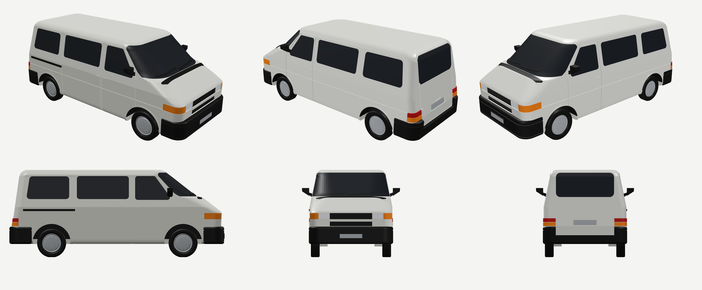
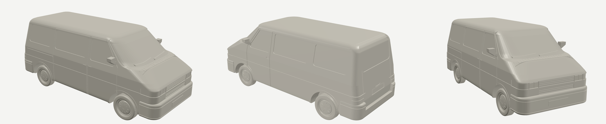
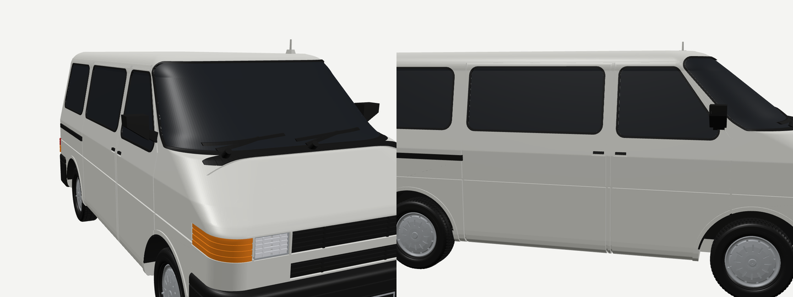

# VW T4 Kurzschnauze (1990–1995) zum 3D-Druck

Modell des VW T4 (Typ 70, Kurzschnauze, kurzer Radstand, Caravelle/Kombi mit
Schiebetür rechts). Die Proportionen sind an einer Seiten-, Front- und
Heckansicht des T4 Kurzschnauze (Baujahr 1990) abgeglichen.





## Dateien

| Datei | Inhalt |
|---|---|
| `vw_t4_1-30.stl` | **Empfohlen.** 1:30, 160 × 73 × 69 mm (mit Antenne), ein Körper, ca. 22 MB |
| `vw_t4_1-30_sockel.stl` | 1:30 mit Unterboden-Sockel, kommt ohne Stützen aus (von der Seite sieht man den Sockel) |
| `vw_t4_1-43.stl` | 1:43, 112 × 51 × 48 mm (mit Antenne) |
| `mehrfarbig_1-30/*.stl` | Teile je Farbe für das AMS (siehe unten) |
| `vw_t4.py` | Generator-Skript (Python, manifold3d) |
| `render_chromium.js` | Vorschau-Renderer (three.js in Chromium) |

## Was am Modell typisch T4 ist

- Kurze, um 37° geneigte Haube, die fast in derselben Linie in die flache
  Frontscheibe übergeht, mit kleinem Knick am Windlauf
- Um die Ecken gezogene Frontscheibe; die A-Säule sitzt weit hinten
- Seitenwände ab der Gürtellinie deutlich eingezogen, Dachkanten gerundet
- Heckklappe nach vorn geneigt, sehr große Heckscheibe
- Frontmaske mit Rechteck-Scheinwerfern (zweigeteilt) und Blinkern um die Ecke.
  Der Kühlergrill ist zweiteilig: oberer Grill mit Lamellen, Querstreb in
  Wagenfarbe, unterer Grill.
- Hohe, schwarze Stoßfänger, die bis an die Radläufe reichen. Hinten ist die
  Ladekante abgesenkt, die Heckklappe reicht dort bis unten.
- Heckleuchten an den Ecken über dem Stoßfänger (rot oben, orange unten)
- Schiebetür rechts mit schwarzer Abdeckung der Führungsschiene, Türfugen,
  seitliche Sicke, Regenrinnen
- Große, schwarze Außenspiegel, Scheibenwischer, Windlaufgitter, Türgriffe,
  Kennzeichen vorn und hinten
- Radläufe mit Lippe und schwarzer Radhaus-Auskleidung, Stahlfelgen mit
  Radkappe, Reifen mit Profil

Feindetails (seit Version 3):
- Gummidichtungen um alle Scheiben (erhaben, schwarz)
- Kühlergrill mit 4 + 3 Lamellen und Stegen. Die Scheinwerfer haben
  Chromrahmen, sind zweigeteilt und haben gerippte Gläser. Die Blinker sind gerippt.
- Rückleuchten mit Kammer-Rillen, Griffleiste mit Kennzeichenleuchte über dem
  hinteren Kennzeichen, Kennzeichen mit Rand
- Scheibenwischer mit Armen und Achsen, dazu ein Heckwischer. Das Windlaufgitter hat feine Schlitze.
- Türgriffe als schwarze Griffe in Griffmulden, Spiegel mit Spiegelglas
- Vorderer Stoßfänger mit unterem Lufteinlass (5 Stege) und Abdeckung der Abschleppöse,
  hinterer Stoßfänger mit Trittrippen an der Ladekante
- Reifen mit Längsrillen, Schulter- und versetzten Mittelblöcken. Die Flanke hat ein Schriftband.
  Radkappe mit 12 Rippen, Nabendeckel und Ventil.
- Antennenfuß auf dem Dach, Auspuff-Endrohr hinten links
- Feinere Netzauflösung (glatte, umlaufende Frontscheibe)

Logos sind absichtlich nicht enthalten.

Hinweise zu den feinen Teilen: Der Antennenstab ist bei 1:30 nur 0,7 mm dick
und kann abbrechen. Wer ihn nicht will, entfernt ihn in `vw_t4.py` (Zeile mit `ant +=`).
Bei 1:43 sind Lamellen und Rippen nur noch etwa 0,3 mm breit. Dafür eine
0,2-mm-Düse verwenden oder mit leichtem Detailverlust rechnen.

## Druck auf dem Bambu Lab P2S (Bambu Studio)

**Einfarbig (`vw_t4_1-30.stl`)**
- Ausrichtung: auf den Rädern lassen (so, wie die Datei geladen wird)
- Profil: 0,4-mm-Düse, *0.08 mm Extra Fine* für die feinen Rippen (oder *0.12 mm Fine*)
- Wände 3, Füllung 10–15 % Gyroid
- Stützen: **Tree (auto), „nur auf der Druckplatte“**. Gestützt werden der
  flache Unterboden, die Stoßfänger-Unterseiten und die Spiegel. Wer keine
  Stützen will, nimmt `vw_t4_1-30_sockel.stl`.
- PLA Matte zeigt die Fugen und Fenster am besten

**Mehrfarbig mit AMS (`mehrfarbig_1-30/`)**
1. In Bambu Studio alle STL-Dateien aus dem Ordner **gleichzeitig** importieren.
2. Die Frage „als ein Objekt mit mehreren Teilen laden?“ mit **Ja** beantworten.
3. Den Teilen die Filamente zuweisen:

| Teil | Farbe |
|---|---|
| `karosserie` | Weiß oder Wagenfarbe |
| `schwarz` | Schwarz (Stoßfänger, Reifen, Grill, Spiegel, Radhäuser, Leisten) |
| `glas` | Schwarz oder Dunkelgrau |
| `silber` | Silber/Grau (Felgen, Kennzeichen) |
| `scheinwerfer` | Weiß/Natur |
| `orange` | Orange (Blinker) |
| `rot` | Rot (Rückleuchten) |

Mit nur 4 AMS-Slots: Glas schwarz drucken und die Scheinwerfer in Weiß,
dann reichen Weiß, Schwarz, Silber und Orange; die roten Leuchten werden dann
z. B. orange oder später bemalt. Das Teil `karosserie` hat ein paar winzige
Kantenfehler an den Fensterdichtungen, die Bambu Studio beim Import
reparieren sollte. Die einfarbigen STLs sind fehlerfrei.

## Anpassen

```bash
pip install manifold3d numpy
python3 vw_t4.py                    # 1:30 + Mehrfarben-Teile
python3 vw_t4.py --scale 25         # 1:25 (~191 mm lang)
python3 vw_t4.py --sockel           # mit Unterboden-Sockel
```

Alle Maße im Skript sind Originalmaße in mm. Die Karosserie entsteht aus
horizontalen Schnitten: Vorderkante, Hinterkante, Breite und Eckradien sind
jeweils als Profil über die Höhe hinterlegt (`XF_PTS`, `XR_PTS`, `W_PTS`, `RF_PTS`).
